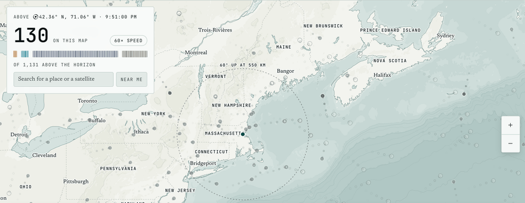

<div align="center">
<picture>
  <source media="(prefers-color-scheme: dark)" srcset="../docs/public/wordmark-night.svg">
  
</picture>

[](https://www.rust-lang.org/)
[](https://github.com/Jybbs/upstairs/actions/workflows/deploy.yml?query=branch%3Amain)
[](https://upstairs.fyi/)

</div>

---

## 🛰️ About

***Upstairs*** counts every active satellite above a spot chosen on a terrain map, lists the passes crossing its sky, and plays them through a window of time. The reader's browser calculates each position from the orbital elements [CelesTrak](https://celestrak.org/) publishes, running the SGP4 orbit model through the [`sgp4`](https://docs.rs/sgp4) crate compiled to [WebAssembly](https://webassembly.org/), and [MapLibre](https://maplibre.org/) draws the terrain map beneath the satellites. A catalog service on [Cloudflare Workers](https://developers.cloudflare.com/workers/) downloads the elements from CelesTrak at most once every two hours, as CelesTrak asks, and every reader's browser reads that copy from `upstairs.fyi`.

<picture>
  <source media="(prefers-color-scheme: dark)" srcset="../docs/public/reel-night.gif">
  
</picture>

---

## 📍 Start Here

<p align="center">
<a href="https://upstairs.fyi/"><picture><source media="(prefers-color-scheme: dark)" srcset="../docs/public/start/map-night.svg"></picture></a>
<a href="https://upstairs.fyi/guide/"><picture><source media="(prefers-color-scheme: dark)" srcset="../docs/public/start/guide-night.svg"></picture></a>
<a href="https://upstairs.fyi/method/"><picture><source media="(prefers-color-scheme: dark)" srcset="../docs/public/start/method-night.svg"></picture></a>
</p>

[Data](https://upstairs.fyi/data/) names where the orbits, the map, and the place search come from and what each request sends, and [CONTRIBUTING.md](CONTRIBUTING.md) lists the tasks, the checks a pull request passes, how a push to `main` deploys, and the labels an issue carries.

---

## ⌨️ Quickstart

[mise](https://mise.jdx.dev/) installs every tool `.mise/config.toml` pins, so once [mise itself is installed](https://mise.jdx.dev/getting-started.html), these commands clone the repository, install its tools and packages, download the catalog, and serve the site locally:

```bash
git clone https://github.com/Jybbs/upstairs.git
mise trust upstairs
mise -C upstairs install
cd upstairs
mise run catalog
mise serve
```

`mise run catalog` downloads the satellite catalog into `docs/public/catalog.bin`. CelesTrak publishes new orbital data every two hours and asks for one download per update, so the task runs only when the catalog itself has to move.

---

## ©️ Attribution

*Upstairs* is released under the MIT License, which [`LICENSE`](../LICENSE) carries. The map draws the data below, and [Data](https://upstairs.fyi/data/) credits each source in full.

- The orbital elements come from [CelesTrak](https://celestrak.org/), which publishes no license for them and makes them freely available to all users
- The map data comes from [OpenStreetMap contributors](https://www.openstreetmap.org/copyright) under the [Open Database License](https://opendatacommons.org/licenses/odbl/) and reaches the map through [OpenFreeMap](https://openfreemap.org/) in the [OpenMapTiles](https://openmaptiles.org/) schema, whose design is licensed under [CC BY 4.0](https://creativecommons.org/licenses/by/4.0/)
- The elevations come from the [Terrain Tiles](https://registry.opendata.aws/terrain-tiles/) dataset, whose sources each carry their own license, with 3DEP, GMTED2010, and ETOPO1 in the public domain, SRTM in the public domain within the United States, and ArcticDEM free to use without permission. The data for Australia and Norway is under [CC BY 4.0](https://creativecommons.org/licenses/by/4.0/), for Austria under [CC BY 3.0 Austria](https://creativecommons.org/licenses/by/3.0/at/), for New Zealand under [CC BY 3.0 New Zealand](https://creativecommons.org/licenses/by/3.0/nz/), for Canada under the [Open Government Licence – Canada](https://open.canada.ca/en/open-government-licence-canada), for the United Kingdom under the [Open Government Licence v3.0](https://www.nationalarchives.gov.uk/doc/open-government-licence/version/3/), and for Mexico under INEGI's free use of information terms, while EU-DEM carries the credit the European Environment Agency sets
